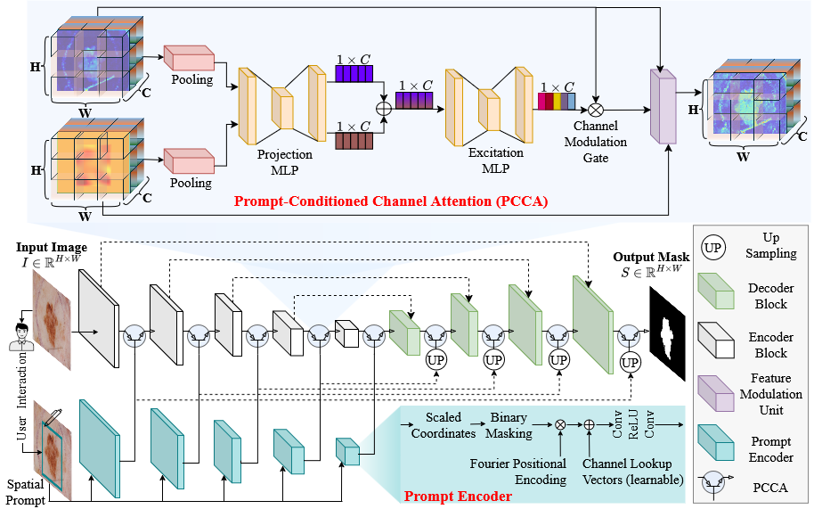

<div align="center">

# 🧠✨ PROMISE-Net
### Prompt-Conditioned Channel Attention for Hierarchical Feature Modulation toward Anatomy-Agnostic Segmentation

[](https://arxiv.org/abs/2608.20229)
[](#)
[](#)

</div>

---

## 📌 Overview

**PROMISE-Net (PROmpt Modulated Integration for SEgmentation)** is a **prompt-aware medical image segmentation framework** built around a novel attention mechanism, **Prompt-Conditioned Channel Attention (PCCA)**.

The core idea is to **integrate a user-provided bounding-box prompt into every stage of an encoder–decoder network**, enabling **hierarchical, prompt-driven feature modulation** instead of shallow or late-stage prompt fusion. During training, we mimic a user-drawn box by generating the bounding box from the ground-truth mask and randomly perturbing it. We also tested the model with boxes drawn by two observers, and the results were close, suggesting it is robust to variation in user interaction.

This repository is the **official implementation** of the proposed model only. Baselines (U-Net, UNETR, SAM) and ablation code are intentionally not included.

---

## 🧩 PROMISE-Net Architecture

<div align="center">
  
</div>

<p align="center">
  <em>
  PROMISE-Net framework with hierarchical Prompt-Conditioned
  Channel Attention (PCCA) integrated across encoder and decoder stages.
  </em>
</p>

---

## 🚀 Key Contributions

### 🔹 Prompt-Conditioned Channel Attention (PCCA)
- A **lightweight, squeeze-and-excitation–style gating module**
- Pooled image and prompt descriptors are projected into a shared latent space, summed, and passed through a small MLP + sigmoid to give a **channel-wise gate**
- Combined with a direct prompt-multiplication term for spatially precise modulation
- See `promisenet/models/pcca.py`

### 🔹 Hierarchical Prompt Integration
- The prompt is fused with image features at multiple stages of the encoder and decoder, not just once at the input or output

### 🔹 Cross-Architectural Generality
- **CNN backbone** → **PROMISE-CNN** (U-Net)
- **Transformer backbone** → **PROMISE-Txformer** (UNETR)

---

## 🏗️ Model Variants

### 🔵 PROMISE-CNN
- Based on **U-Net**
- Strong at local textures and boundaries
- Lightweight and efficient

### 🟣 PROMISE-Txformer
- Based on **UNETR**
- Global self-attention for long-range dependencies

Both variants use **the same PCCA module**.

---

## 🧪 Datasets Supported

| Dataset | Task | Modality | Classes |
|------|------|------|------|
| 🧴 ISIC-2017 | Skin lesion segmentation | Dermoscopy | 2 |
| 🦠 Kvasir-SEG | Polyp segmentation | Endoscopy | 2 |
| 🛠️ Kvasir-Instrument | Tool segmentation | Endoscopy | 2 |
| ❤️ CAMUS | Cardiac chamber segmentation | Echocardiography | 4 (bg + LV + MYO + LA) |

Download links, licenses, expected layouts and the offline-augmentation scripts are in [docs/DATASETS.md](docs/DATASETS.md). ISIC-2017 is trained on the raw split with no augmentation, per the paper's protocol.

---

## ⚙️ Installation

The project uses [uv](https://docs.astral.sh/uv/) with a local `.venv`.

```bash
uv sync
```

`pyproject.toml` pulls PyTorch from the **CUDA 12.8** index, so RTX 50-series (Blackwell) GPUs work. Check with:

```bash
uv run python -c "import torch; print(torch.__version__, torch.cuda.is_available())"
```

If you prefer pip, `pip install -r requirements.txt` also works, but it installs the default PyTorch wheel (CPU-only on Windows). Install a CUDA build of PyTorch first.

---

## 🏋️ Training

```bash
uv run python train.py --config configs/isic2017.yaml          --model cnn         --data_dir ./data/ISIC_2017
uv run python train.py --config configs/isic2017.yaml          --model transformer --data_dir ./data/ISIC_2017
uv run python train.py --config configs/kvasir_polyp.yaml      --model cnn         --data_dir ./data/kvasir_polyp_augmented
uv run python train.py --config configs/kvasir_instrument.yaml --model cnn         --data_dir ./data/kvasir_instrument_augmented
uv run python train.py --config configs/camus.yaml             --model transformer --data_dir ./data/camus_augmented
```

- `--model cnn` trains PROMISE-CNN, `--model transformer` trains PROMISE-Txformer
- Each `configs/*.yaml` holds the per-dataset hyperparameters (loss weights, augmentation)
- Optional: `--epochs`, `--batch_size`, `--out_dir` (default `./outputs`)
- Checkpoints: `<dataset>_<model>_best.pth` (best val Dice) and `<dataset>_<model>_latest.pth` (written when training finishes)

Prompts are bounding boxes extracted automatically from the ground-truth masks and loosened by a few pixels to mimic a hand-drawn box. See `promisenet/data/bbox_utils.py`.

---

## 📈 Evaluation

```bash
uv run python test.py --config configs/isic2017.yaml --model cnn \
    --data_dir ./data/ISIC_2017 --weights outputs/isic2017_cnn_best.pth --out_dir outputs/isic2017_cnn_test
```

Outputs in `--out_dir`:
- `metrics.csv`: per-image DSC, IoU, HD95, FNR, FPR (per class for CAMUS)
- `metrics_summary.csv`: mean and std
- `predictions/`: predicted masks

For CAMUS, report the **mean over the foreground classes (LV, MYO, LA)**. Including the background class inflates the score.

---

## 🗂️ Project Structure

```
PROMISENet/
├── promisenet/
│   ├── models/
│   │   ├── pcca.py                 PCCA module + bounding-box prompt encoder
│   │   ├── promisenet_cnn.py       PROMISE-CNN (U-Net + PCCA at every stage)
│   │   └── promisenet_txformer.py  PROMISE-Txformer (UNETR + PCCA)
│   ├── data/
│   │   ├── datasets.py             ISICDataset, CAMUSDataset, KvasirDataset
│   │   └── bbox_utils.py           Automated bounding-box extraction from masks
│   ├── losses.py                   Dice/CE loss, per-dataset weighting
│   └── metrics.py                  DSC/IoU/HD95/FNR/FPR
├── scripts/
│   ├── augment_utils.py            Offline augmentation (H/V flip, rotate, combined)
│   ├── prepare_camus.py            CAMUS augmentation CLI
│   └── prepare_kvasir.py           Kvasir-Polyp / Kvasir-Instrument augmentation CLI
├── configs/                        Per-dataset hyperparameters (one YAML each)
├── static/                         README images
├── docs/DATASETS.md
├── train.py
└── test.py
```

---

## 📚 Citation

```bibtex
@misc{hossain2026promptconditionedchannelattentionhierarchical,
      title={Prompt-Conditioned Channel Attention for Hierarchical Feature Modulation toward Anatomy-Agnostic Segmentation},
      author={Mosharof Hossain and Md Rabiul Islam and Limon Halder and Erchin Serpedin and Md Kamrul Hasan},
      year={2026},
      eprint={2608.20229},
      archivePrefix={arXiv},
      primaryClass={cs.CV},
      url={https://arxiv.org/abs/2608.20229},
}
```

## 📄 License

See [LICENSE](LICENSE).
